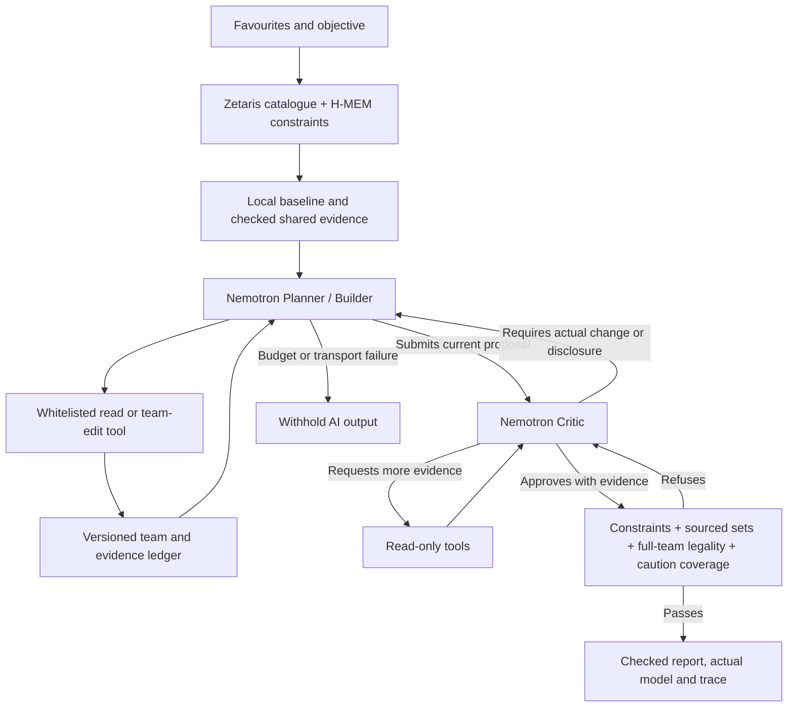

# Bounded Nightshift AI reasoning

> This records the published Demo 2 architecture. The current development flow
> starts with the Critic and adds targeted repair contracts and explicit
> continuation. See [current reasoning acceptance](REASONING_ACCEPTANCE.md).

This extends Demo 1's local tools into an explicit Planner/tool/Critic workflow.
It uses the existing Nemotron model; it does not train a new model. The current
live-verification status must be read in VERIFICATION.md. Mocked tests are never
presented as live AI results.

## Run modes

- Local planning remains the default and makes no model requests.
- Offline sample always makes no model requests. Combining `--sample --ai` is
  rejected before data loading or transport.
- Nightshift AI is an explicit GUI choice or `--ai` CLI flag and requires local
  connected Zetaris data and the Nightshift runtime token.

```powershell
python team.py --ai --favourites Charizard --objective simple --profile ai-coach
```

Objectives are `simple`, `sun`, `rain` and `trick-room`. They are preferences, not
promises that a particular style is optimal for the locked favourites.

The app calls only the local Nightshift `/v1/chat/completions` endpoint, requesting
`nvidia/nemotron-3.5-lightning-30b-a3b`. It checks the actual returned model identity;
an alias or a different model is insufficient evidence and the output is withheld.
There is no direct NVIDIA/OpenAI API fallback. The legacy credit gate remains
unchanged and is not enabled by the new feature.

## State machine and authority



Roles communicate through compact JSON commands interpreted by the controller; no model-written code or SQL is executed.

The Planner and Critic are distinct roles using the same model, not independent
sources of truth. The model chooses tools and concrete changes. Local code
executes tools, restricts authority and checks output. A good existing baseline
may be retained; no artificial failure or revision is forced for a demonstration.

## Tools

| Tool | Role | Scope |
| --- | --- | --- |
| `inspect_team` | Planner or Critic | Current legality, locks, avoidance, stats, supported interactions and evidence |
| `search_partners` | Planner or Critic | Up to six supported choices by historical association and permitted role/weather filters |
| `get_sets` | Planner or Critic | Up to six prepared source set IDs in current team context |
| `build_candidate` | Planner only | Preserve original locks/avoidance, retain selected partners and fill slots locally |
| `change_set` | Planner only | Apply a previously issued set ID for an existing member |

No tool executes arbitrary Python, shell commands, SQL, URLs or a model/provider
switch. The loaded catalogue comes from the real Zetaris adapter in connected
mode. Agent tools search that bounded retrieved view rather than sending arbitrary
model-written SQL to the database.

## Grounding and revision

Every inspected team has a version, fingerprint and evidence IDs. Mutations must
use full prepared set options, preserve constraints and pass the independent
Showdown team validator before becoming the working state. A mutation creates a
new version; old evidence IDs cannot justify the new team.

The Critic can require a real change or explicit disclosure of a trade-off. A
change-required criticism blocks resubmission until the team version actually
changes. Remaining supported cautions must all be acknowledged before approval.
Critic approval cannot override hard constraints or validation.

The model selects checked evidence and strategy; final factual text comes from
the tools. Arbitrary model prose, invented numbers, confidence percentages and
uncomputed knockout/win guarantees are not part of the publishable schema.
Traces record concise decisions/actions, not hidden chain-of-thought.

## Bounds and failures

- At most 8 model requests, 12 tool calls and 2 critic revision rounds.
- At most 8,192 output tokens per model request and a bounded input payload.
- Streaming responses are collected privately and validated only after completion;
  no partial answer is published. Preliminary Nightshift routing aliases require
  a final concrete approved model identity. Missing completion or error frames stop
  the run. A normal JSON response from a compatible gateway is also accepted.
- An approximately 8-minute model-run deadline, with shorter per-request limits.
- No automatic transport retries, redirect following, inherited HTTP proxies or
  fallback to a different provider.
- HTTP authorization/rate-limit/service errors, malformed or truncated content,
  mismatched model identities and exhausted budgets withhold the AI report.
- One new structured-format request may repair invalid JSON within the same
  eight-request budget. It never retries an HTTP failure. Repeated reads for the
  same role/team version are refused.
- The user can explicitly start a separate local-planning run; a failed AI run
  never silently becomes a local result labelled as AI.

NVIDIA advertises a free prototype endpoint for this model. Account limits and
provider availability still apply; ChatGPT/Codex allowances are separate. This
does not claim an unlimited or production-SLA service.

## Reasoning-track evidence

| Supplied judging expectation | Implementation and verification |
| --- | --- |
| Meaningful specialised roles | Planner/Builder chooses tools and changes; Critic has read-only tools and blocking authority |
| Repeated interaction | Evidence-linked revision returns to the Planner and is reviewed again |
| Useful shared state | Versioned working team, checked evidence, original constraints and recalled H-MEM preferences |
| Criticism changes output | Regression fixture repairs a legal but unsupported Psychic Seed set after a critic requires a change |
| Reliable decisions/actions | Source IDs, full-set checks, final validator, stale-citation rejection and bounded refusal |
| Traceability | Requested/actual model, usage when returned, tool arguments, source, versions, changes and approval/refusal |
| Honest demonstration | Live and simulated execution labels; unchanged baseline is explicitly reported as unchanged |

These are concrete implementation mappings, not awarded scores or a claim of
competitive team quality. Impact still needs beginner testing; the final video
and slides must show a real run and a useful decision or revision.

## Verification

```powershell
python -m unittest -q test_coaching test_hmem test_team_builder test_project_status test_battle_guidance test_ai_coach
node verify-hmem.cjs
```

`test_ai_coach` simulates model decisions. It tests real local tools/validation,
critic-blocked revision, evidence freshness, refusal boundaries, request limits,
redaction and end-to-end report behaviour. It does not call a hosted model.
