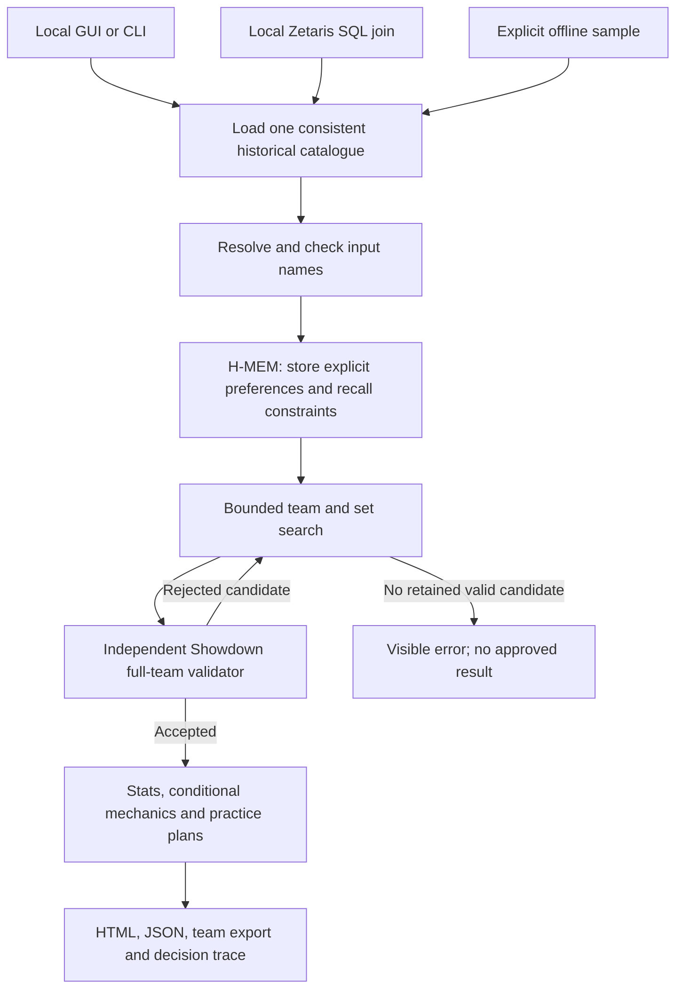

> Demo 1 architecture is preserved below. The current explicit AI extension is
> documented in [AI reasoning](AI_REASONING.md); default local/sample behaviour
> remains available. Its live verification status is in the root verification log.

# Architecture

## Product boundary

Demo 1 is a local application with algorithmic planning, factual coaching and a
real Meterless H-MEM preference feature. The named planner/evaluator components
are local code, not independent LLM agents. There is no cloud-model request in
the `app.py` → `team.py` product path.

Zetaris and sample mode provide the same prepared schema. A failed connected
query is an error, not permission to switch to the bundled sample automatically.

## Execution sequence

1. Create a unique run directory. Reusing a run ID is rejected.
2. Load the selected data source and record its identity and historical format.
3. Resolve explicit names. Read/write the first favourite and one avoidance in
   the selected H-MEM profile; retrieve preferences across a child process.
4. Validate the effective roster constraints. Reject unknown names, banned or
   unsupported builds, duplicate species/forms and lock/avoid conflicts.
5. Search over sourced set variants while preserving locked species.
6. Validate complete retained candidates with Showdown, trying the next retained
   candidate if validation rejects one. Withhold output if none passes.
7. Compute explanations and supported interaction checks from data and code.
8. Write all report artifacts; only then append the successful terminal event.

Input handling is layered. Some invalid combinations are rejected in the builder
after explicit preferences have reached memory; it is not a transactional memory
rollback system. An approved team must still satisfy the recalled constraints.

## Search and evaluation

`TeamScorer` exposes six terms: historical usage, set evidence/usability, support
roles, original-type balance, field/partner interactions and historical
co-occurrence. Cached member and pair features keep the search practical.

The planner retains up to ten candidates per step. Its species pool includes
roughly the 45 most-used supported choices plus up to ten historical partners per
locked species. Available set options are ranked in the current team context;
up to three are expanded per candidate species. Full set identity is used for
deduplication, so different move/nature options are not lost as item-only ties.

This is a bounded heuristic search, not exhaustive optimization. Scores can trade
off competing objectives and do not predict win rates. The 85 effective-Speed
cutoff used for identifying a possible slow mode is a heuristic, not a VGC rule.

The legality evaluator is separate from the quality score. A legal result may
still be strategically weak; a quality caution may remain necessary when the
user locks conflicting favourites. No locked species is silently replaced.

## Coaching mechanics

`battle_guidance.py` computes level-adjusted stats using base stats, EVs, IVs and
nature with integer rounding. Its Speed examples cover explicitly supported item,
weather, Tailwind and Unburden conditions at neutral stages. They do not simulate
all abilities, statuses, suppression, opposing sets or turn order.

Interaction checks produce named codes, affected Pokémon, a severity, an
explanation and a heuristic penalty where relevant. Checks include competing
weather/terrain, Psychic Terrain versus hostile priority/Prankster moves, terrain
seeds, sleep-blocking terrain, ally-hitting spread moves, weather-dependent moves,
Choice locks and repeated Trick Room. Some common ability immunities are checked
for ally hits. These are not a complete damage or field simulator.

Opening pairs are ranked separately using their supported interactions. Each
receives possible actions and cautions. Back pairs are selected with the local
team score; their four-of-six plans are examples to reassess after seeing an
opponent. They are not opponent-aware recommendations.

## H-MEM integration

The Apache-2.0 Meterless reference core is vendored at commit
`1742dec56a66e58eef9dda2d2b865823758ca8cd`. Source hashes and attribution are in
`vendor/hmem/UPSTREAM.json`.

Python sends a JSON request to `hmem-bridge.mjs` over stdin. The bridge uses the
reference engine, stores source/provenance and audit history, and returns recalled
preferences. The application enforces avoidance independently of generated text.
Profiles have separate stores and restrictive identifier validation; a profile
lock prevents concurrent writes. Corrections supersede records rather than
silently erasing their history. Explicit avoidance clearing is audited.

The facade persists retrieval access counters. Reference hash embeddings run
locally; no embedding API is called. Automatic memory mining, dreaming and sleep
are not app features. The app remembers only the first favourite, not a complete
six-member roster. Local profiles provide storage separation, not multi-user
authentication or encryption.

## Modules and artifacts

| File/directory | Responsibility |
| --- | --- |
| `app.py` | Loopback HTTP form, report routes, request token and progress polling |
| `team.py` | End-to-end orchestration, CLI and trace lifecycle |
| `catalogue.py` | Explicit sample adapter, local Zetaris REST adapter, Showdown process bridge |
| `team_builder.py` | Constraints, bounded search, score terms and team explanations |
| `battle_guidance.py` | Stats, conditional Speed, supported interactions and opening advice |
| `showdown-bridge.cjs` | Local set generation, team validation and reference test operations |
| `reference-mechanics.cjs` | Independent running-simulator test fixtures |
| `hmem_memory.py`, `hmem-bridge.mjs`, `hmem-engine.mjs` | H-MEM process boundary and app facade |
| `report.py` | Escaped portable HTML rendering |
| `project_status.py` | Recorded project status and progress derived from trace events |
| `data/` | Prepared public sample, source manifest and three Zetaris CSVs |
| `runs/<id>/` | Private local reports, exports and traces; ignored by Git |
| `.doublescheck-memory/` | Private local preferences and audit storage; ignored by Git |

Legacy cloud-model experiments remain separately gated. They do not sit on the
current GUI/CLI path. See the operational guide for cost and service boundaries.
