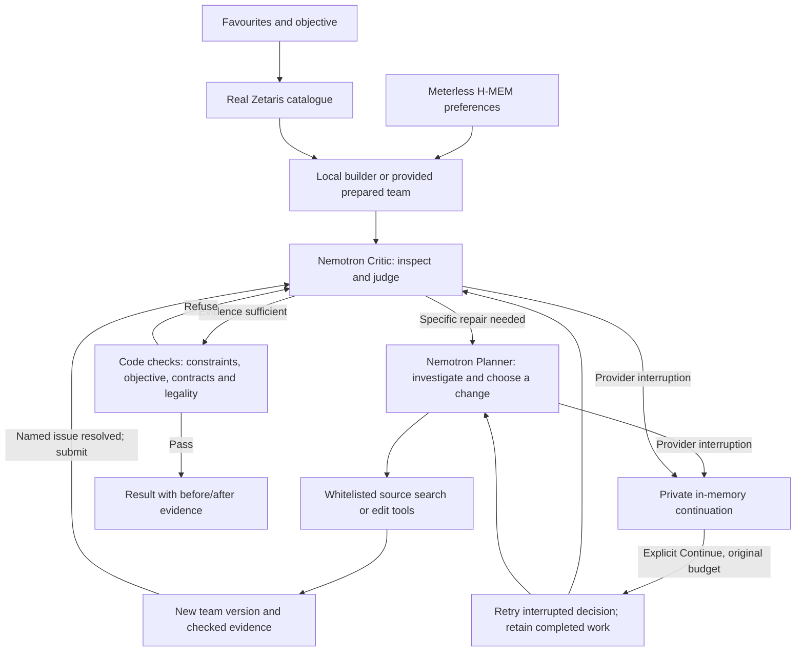

# Checked reasoning and acceptance

The current development version strengthens Demo 2 in three areas: live
reliability, real model-driven correction and varied user situations. It uses
NVIDIA Nemotron through local Nightshift; it does not train a foundation model.
Actual live attempts and scripted regression tests are separate evidence.

## Dynamic roles and authority



The local builder is deterministic. A satisfactory candidate can finish after
Critic inspection and approval without invoking a model Planner. A specific
criticism dispatches the Planner and returns its revision for review. Reports
name roles that actually ran, rather than claim unused agents as collaboration.

The roles use the same approved model and are not independent factual
authorities. Code retains final authority. The Critic has read-only tools; only
the Planner may mutate the candidate. No tool executes arbitrary model-written
Python, shell commands, SQL, URLs or provider changes.

## A revision must fix its named problem

Criticism cites a checked current fact and requests `change` or `disclose`.
A change creates a revision contract. A condition contract stays open while that
specific condition remains; an unrelated legal edit is insufficient. A member
contract requires that member to change. Global conflicts stay open while the
conflict persists, even if its suppliers change. Disclosure is never counted as
a repair.

Each mutation receives a new team version and full-set fingerprint covering
species, moves, item, ability, nature, EVs, IVs, Tera and level. Old evidence and
old context-specific set options cannot justify a new version. The changed
version must have fresh checked facts before resubmission. Edit tools return
the full validated state atomically, avoiding an extra model round trip just
to request those same facts. This automatic validation is not counted as an
additional AI-requested tool. When required repairs are
resolved, the Planner hands back instead of indefinitely optimising.

The original criticism stays in the audit. Obsolete IDs and completed repair
instructions are removed from active context. Roles share source options; they
need not reissue IDs to each other. One focused source investigation is permitted
per Critic review/version before it must issue a verdict.

## Tools and evidence

| Tool | Authority | Checked result |
| --- | --- | --- |
| `inspect_team` | Either role | Constraints, legality, members, conditions and current evidence IDs |
| `search_partners` | Either role | Up to six source choices with role/weather filters |
| `get_sets` | Either role | Up to three diverse prepared choices and computed condition changes |
| `build_candidate` | Planner | Preserve locks/avoidance, retain selected partners, fill slots locally |
| `change_set` | Planner | Apply a current issued set ID and validate the full team |

`repair_condition` requires a current issue ID affecting that species. Options
are filtered by whether they remove the named checked condition. The model still
chooses an option or another permitted approach. No live verdict is scripted.

All remaining cautions must be acknowledged, with at least two distinct current
evidence IDs at approval. Free model prose, invented confidence, damage guarantees
and private chain-of-thought are not publishable fields. Explanations use checked
facts and actual before/after changes.

## Objectives and provided teams

Objectives are `simple`, `sun`, `rain`, `trick-room` and `reliable`. Custom
objectives require explicit AI mode. Selected weather/Trick Room support is
checked. The `reliable` goal targets the documented missing automatic weather/seed
support, charge-turn and unusable Assault Vest/status conditions. It does not
promise unconditional item activation or complete mechanic coverage. Manual
weather and unmodelled plans are not certified by these checks.

A counterproposal must cite the unmet objective; the report labels it as an
alternative. Disclosure is not fulfilment. A goal-specific acceptance case can
fail even when the application approves a valid alternative team.

`--review-team` accepts a JSON list or previous report containing six exact
prepared source sets. It discards extra input metadata. This is not an unrestricted
Showdown importer. Specify the locked favourites explicitly; remembered avoidance
still applies. Invalid source sets, species/item conflicts and missing locks are
checked before preference updates or model requests.

## Transport and recovery

- Only local Nightshift is called, requesting
  `nvidia/nemotron-3.5-lightning-30b-a3b`.
- Authenticated discovery must advertise the concrete model before a model
  request. A health badge or routing alias alone is insufficient.
- Streams require completion and final approved model identity. Preliminary
  `meterless/auto` frames are not final proof.
- Eight lifetime model requests, twelve tools and two revision rounds per review.
  Failed requests and explicit continuations count too.
- One completed malformed-JSON command may receive a counted format repair.
  Broken envelope/transport data does not trigger that repair.
- Time/input/output/response-size limits remain enforced. The hard output cap is
  8,192 tokens. A 1,024-token thinking-budget hint is requested; enforcement by
  the installed gateway is not established and is not claimed.
- No inherited proxies, redirects, direct NVIDIA/OpenAI calls or paid fallback.

A retryable interruption may retain suspended state in RAM. **The GUI sends no
automatic retry.** Continue retries the interrupted decision within the original
request budget. Completed retrieval, building, searches and mutations are not
replayed. Partial model text is never used as a completed command.

Continuation lasts up to 30 minutes while the same app process remains open,
with at most four paused reviews retained. Restarting loses them; no
credential-bearing session is serialized. Human waiting time is excluded from
remaining active time, while active time and request counts are retained. Changed
preferences invalidate continuation before another model request. Concurrent or
repeated continuation cannot duplicate requests.

The acceptance CLI defaults to no continuation. `--resume-once` explicitly
authorises one continuation per case, recorded in its report and bounded by case
and suite limits. This is not a provider SLA or unlimited/free quota guarantee.

## Reproducible acceptance matrix

| Case | Required evidence |
| --- | --- |
| One favourite | Preserve Charizard, fill six legal members and honour avoidance |
| Three favourites | Preserve all three without claiming every combination is optimal |
| Six favourites | Preserve six and select feasible distinct items |
| Remembered avoidance | Recall through a fresh H-MEM process without restating preferences |
| Memory changes team | Stored avoidance removes Torkoal from a candidate otherwise containing it |
| Seed repair | Critic requires change; Planner chooses a sourced repair; condition disappears; revised team is approved |
| Rain objective | Check selected support and whether the requested mode was delivered |
| Locked trade-offs | Retain six despite competing field effects and disclose conditions |
| Restricted/unsupported/unknown species | Refuse before a model request; never invent a build |
| Duplicate species | Reject Species Clause conflict before changing preferences |
| Conflicting preferences | Refuse incompatible locks/avoidance without corrupting memory |

```powershell
# Real local checks; no model calls
python evaluate_reasoning.py

# Real connected services, declared repair fixture and an eight-request cap
python evaluate_reasoning.py --live --cases seed-repair --max-model-requests 8

# Explicitly authorise one continuation without resetting budgets
python evaluate_reasoning.py --live --cases seed-repair --max-model-requests 8 --resume-once
```

The seed case is a historically legal sourced team with a deliberately unmatched
Psychic Seed/Unburden combination. It is not claimed as a spontaneous default-
builder failure. Live mode uses real Zetaris, H-MEM and genuine model responses.
The evaluator records failed attempts, expected refusals, approved teams, unmet
expectations, models, requests, continuations and implementation fingerprints.

Offline mode verifies actual local search, validation, condition detection and
memory, not AI correction. Rain is skipped offline rather than marked achieved.
Live mode never substitutes sample data after a failure. An expected refusal is
a successful guard test, not a successful AI review. Different development
iterations must not be merged into one claimed success rate.

Regression suites additionally cover forbidden tools, forged sets, stale IDs,
unrelated edits after criticism, objective counterproposals, duplicate citations,
provider failures, continuation budgets, preference changes, expiry/concurrency
and authenticated HTTP interaction. Simulator references check selected mechanics.

## Supplied rubric mapping

| Expectation | Concrete evidence |
| --- | --- |
| Specialised roles | Read-only Critic; Planner edits; source choices pass between them |
| Dynamic interaction | Good candidate can finish without Planner; criticism dispatches it |
| Criticism changes output | Named contracts reject unrelated edits and unresolved conditions |
| Shared knowledge/state | Zetaris choices, locks, H-MEM preferences, versions and evidence |
| Recovery | Explicit continuation retains state, tools and lifetime budget |
| Traceable output | Actual model, commands, contracts, before/after sets and objective assessment |
| Honest demonstration | Real/simulated evidence separated; failed and unmet cases retained |

This mainly strengthens Technical (20), supplies Demo (15) reasoning evidence and
demonstrates working Sponsor Tech (10). It supports Innovation (15) but does not
prove uniqueness. Impact (30) and UX (10) still need player feedback. These are
implementation mappings, not awarded scores or complete eligibility assurance.

Provider controls: [NVIDIA Nemotron documentation](https://docs.nvidia.com/nim/large-language-models/2.0.10/get-started/advanced/get-started-nemotron-3.5-lightning.html).
