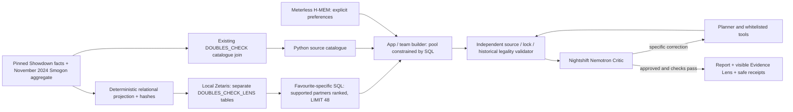

# Zetaris Evidence Lens — bounded submission upgrade

The frozen baseline is `demo-3`, commit `acc708bf565d786e1d1d1bcde3903fe8229b7192`.
This upgrade was developed separately on `challenge/zetaris-evidence-lens`.
No second month, PokéAPI ingestion, opponent preview or new battle solver is included.
The original saved genuine Sneasler repair and explicit offline demonstration remain intact.

## Why Zetaris is central

In connected mode, a favourite-specific SQL query joins facts, usage, teammate
relationships, available set counts and source metadata. It excludes locked and
avoided species, orders candidates by summed historical association weight, then
usage and name, and returns at most 48 partners. The builder cannot silently widen
that returned pool. Changing that pool can change the recommended team.

For example, real local SQL returned Torkoal first for Charizard and Archaludon
first for Pelipper. This is a co-occurrence signal to investigate, not proof of
the strongest partner. Python still selects compatible sets and scores team fit;
the independent historical validator still decides whether the full team is legal.

The old full-catalogue join remains: the agent and validator need descriptions,
legal source choices, move details and all supported species. Retaining those
facts does not mean Python secretly regenerates the connected shortlist.
The set-repair tool still searches the live-loaded prepared catalogue in Python;
moving that second decision into SQL was deliberately deferred to preserve the
tested Critic → Planner → Validator workflow.

**One-sentence “why it was amazing”:** Changing my favourite changes a real
Zetaris SQL shortlist, and I can inspect the historical evidence behind the
partners before trusting the AI's checked advice.

## Architecture



Nightshift is the sole product-model gateway. No OpenAI key, direct paid endpoint,
automatic transport retry or provider fallback was introduced. Role budgets,
revision contracts, manual continuation, locks and historical legality are unchanged.

## Source tables, grains and rights

All tables are projections of the **same** existing snapshot. Normalisation does
not add battles, observations, users or new months. Aggregate battle coverage is
**965,304 once**, not multiplied by the number of tables or joins.

| Table in `DOUBLES_CHECK_LENS` | Rows | Row grain / version | Source date and rights / limitations |
| --- | ---: | --- | --- |
| `pokemon_facts` | 1,417 | One species/form; name, canonical ID, base species, two types, eligibility and prepared-set count; schema 1 | Showdown `0.11.11`, MIT; historical format commit in original manifest; forms are not distinct Pokédex species |
| `usage_snapshots` | 358 | One species/form × format × month × cutoff | Smogon November 2024, Regulation H, cutoff 1500; weighted ladder usage, not wins or official championships |
| `teammate_relationships` | 114,142 | One directed favourite → partner × historical snapshot | Same aggregate; raw association weight is not a compatibility probability or causal benefit |
| `sourced_sets` | 11,376 | One generated, individually validated option; stable set ID and SHA-256 | Separate item/ability/move/spread marginals combined by this project; not jointly observed sets; default 31 IVs |
| `source_metadata` | 1 | One pinned snapshot identity, schema version, hashes, cutoff and battle coverage | Snapshot retrieved 23 October 2026; not current-2026 format advice |

The original `data/sources.json`, source URLs, hash pins and third-party notices
remain unchanged. Smogon data remains attributable to its owners; this project
does not assert a new redistribution licence or grant broader franchise/data
rights. No official Pokémon artwork is included. See `THIRD-PARTY-NOTICES.md`.

`data/zetaris-lens/manifest.json` pins each prepared CSV's bytes and expected row
count. Registration verifies those hashes before copying public files. Each run
checks live table counts, unique keys, format/month/cutoff/source identity and
returned partner values against the pinned catalogue. These checks are not a
cryptographic checksum of every live database cell on every query.

## Exact clean setup and registration

Prerequisites: Python 3.10+, Node 22+, npm, the event's supplied local Zetaris
Docker stack and a running Docker Desktop Linux engine. Use local credentials;
the repository never supplies a private `.env`.

```powershell
git clone https://github.com/arhumamjad07/DoublesCheck.git
cd DoublesCheck
# Check out the reviewed submission commit/branch containing this guide.
npm.cmd ci --ignore-scripts --omit=optional --no-audit --no-fund
python -m venv .venv
.\.venv\Scripts\python.exe -m pip install -r requirements.txt
Copy-Item .env.example .env
# Edit .env locally with your Zetaris settings; never show it on a recording.
docker compose --project-directory C:/zetaris-platform up -d
# Wait for postgres, driver, api and ui to be healthy.
.\.venv\Scripts\python.exe register-data.py --compose-dir C:/zetaris-platform
.\.venv\Scripts\python.exe zetaris_schema.py
.\.venv\Scripts\python.exe register-evidence.py --compose-dir C:/zetaris-platform
.\.venv\Scripts\python.exe -m unittest discover -q
node verify-hmem.cjs
.\.venv\Scripts\python.exe app.py
```

`register-evidence.py` creates/retains the separate `DOUBLES_CHECK_LENS` database
and dedicated driver folder. It does not drop or overwrite Demo 3's original
tables or folders. Repeating registration copies the same pinned public CSVs;
existing registrations are retained. It does not erase saved app runs or memory.

On Windows PowerShell, `npm.cmd` avoids the script execution-policy error from
`npm.ps1`; do not weaken the system execution policy. On macOS/Linux use `npm`.

To repeat the actual HTTP recording path after starting a fresh app:

```powershell
.\.venv\Scripts\python.exe verify-evidence-path.py
```

This makes two real connected builds and checks the clearly labelled saved repair,
with zero model requests. A browser rehearsal is still required.

For an offline-only demonstration, skip `.env`, Docker and both registration
commands, start the app and explicitly select **Offline sample**. The original
offline builder is preserved. Its pool heuristic differs from the new SQL pool;
default teams across the two modes need not match. Tests compare identical data,
SQL ranking with an independent sample projection, and output with an equal pool.

AI mode additionally needs Nightshift and the approved NVIDIA Nemotron provider
configured as in `docs/AI_REASONING.md`. The evidence demonstration itself uses
Local planning and makes **zero model requests**.

## Three-minute Demo Challenge runbook

Start with services healthy, a clean demo profile/app setup and the reviewed
submission checkout. Open `http://127.0.0.1:8765`. Rehearse using this exact order:

1. **0:00–0:20:** Say the problem: a beginner wants a team around a favourite but
   cannot assess partners or conditions. State historical Regulation H / November 2024.
2. **0:20–0:55:** Enter **Charizard**. Select **Connected data**, **Local planning**,
   leave avoidance empty and check **Clear my previous avoided teammate**.
   Build. Point at the Evidence Lens, live completed-query status, 356 candidates,
   48 returned rows, Torkoal evidence, selected rows and historical battle coverage.
3. **0:55–1:15:** Expand the sanitised receipt. Point at purpose, source tables,
   timestamp, duration and an application-generated query ID. It contains no raw
   SQL, credentials, URL, request headers or server response. The ID identifies
   this app measurement; it is not claimed as a Zetaris server-issued audit ID.
4. **1:15–1:55:** Return to Build a team. Enter **Pelipper**, keep the same modes
   and clear avoidance again. Build. Show the changed input and **Archaludon**
   association at the top of the SQL results. Show that the actual proposed team
   changes while the locked favourite remains. Query duration is observed, not a guarantee.
5. **1:55–2:30:** Open **Saved genuine Demo 3 repair** from the homepage. Say
   **“This next view is a saved genuine model run from 25 October, not a live run.”**
   Show `missing_seed_terrain`, resolved v1→v2, Psychic Seed→Focus Sash and
   Unburden→Poison Touch. Define the internal AI Critic and independent validator.
6. **2:30–3:00:** Explain H-MEM preferences, Nightshift/NVIDIA reasoning and the
   source/legality boundary. Admit that usage is not win rate and competitive
   player testing remains. Mention that offline mode is a deliberate separate
   choice and connected failures withhold a result.

If the query errors, **stop the live claim**. Do not present cached/saved data as
live. Use the clearly labelled saved model report and explain the interruption,
or use frozen Demo 3. Do not spend submission time adding new capabilities.

## Recording safety checklist

- Record the app window, not the whole desktop; close notifications and unrelated tabs.
- Never open `.env`, provider token panels, Docker environment settings or unreviewed logs.
- The receipt is constructed from a field allowlist. It has no SQL, endpoints,
  transport headers, arbitrary response metadata or private filesystem paths.
- Receipts describe completed queries for that run; they are not continuous health monitoring.
- Show the historical format/month/cutoff and caveat alongside battle coverage.
- Identify saved runs aloud and on screen. Do not imply a multi-minute AI repair ran instantly.
- Keep the same pinned input fixture; never edit a recorded verdict or invent an agent log.
- Rehearse the exact runbook twice; record observed timings and outcomes, including failures.
- Before public commits, audit tracked files and history for real credentials and private state.

## Claims and boundaries

**We may say:** real authenticated local SQL; five queryable relational tables;
favourite-specific SQL shortlist constrains connected planning; inspected source
evidence; independently checked historical legality; preserved genuine AI repair.

**We must avoid:** 114,142 battles (those are directed relationship rows); usage
equals win rate; all prepared combinations were observed; current-2026 legality;
optimal teams; measured user benefit; competitive superiority; uninterrupted
provider reliability; official Pokémon affiliation; new data rights; Grok/SpaceXAI
work performed by Codex. The existing sceptical Discord outreach was informal,
not hands-on testing or endorsement.

## Deferred bounded SpaceXAI / Grok task

See `GROK_REVIEW_PROMPT.md`. Tool identity/eligibility must be confirmed with the
organisers. No work in this branch is attributed to Grok or SpaceXAI. Reserve a
real, isolated schema/SQL review and order-invariance integration test for that
tool. Record its genuine activity and diff; do not merge unverified late changes.
